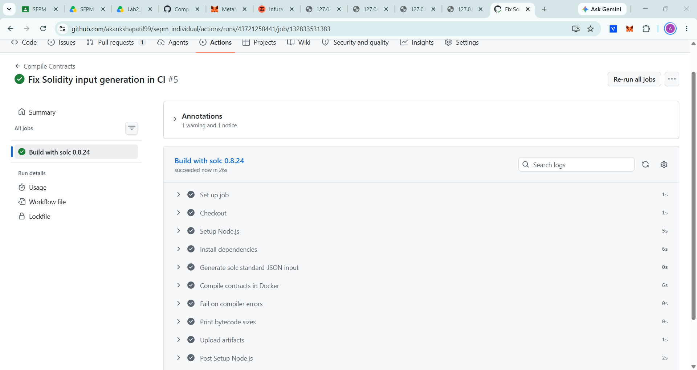

# Solidity Contract Compilation

This project compiles the Solidity contracts in `contracts/` with Solidity 0.8.24. It generates standard JSON compiler input and runs the compiler in Docker. A GitHub Actions workflow also compiles the contracts on pushes and pull requests to `main`.

## Requirements

- Node.js and npm
- Docker with Docker Compose

## Compile locally

Install the project dependencies and run the compile script from the project directory:

```powershell
npm install
npm run compile
```

The script generates `build/input.json`, runs the Solidity compiler in Docker, and writes the compiler output to `build/output.json`. On success, the terminal prints `Compilation OK`.

## Build screenshots

### Local compilation

The terminal shows the contract compilation completing successfully.


### Dependency installation

The project dependencies install successfully with npm.


### GitHub Actions build

The GitHub Actions workflow completes successfully.


### Build workflow steps

The compile job's individual steps all complete successfully.


### CI fix verification

The GitHub Actions run succeeds after correcting the Solidity input-generation script path.


